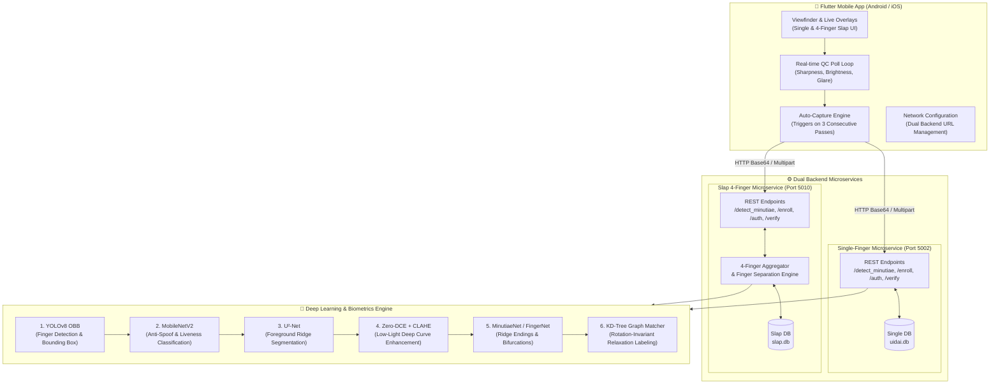
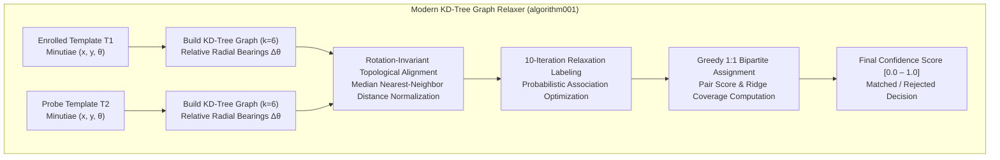
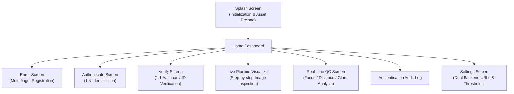

# UIDAI SITAA — Contactless Biometric Fingerprint Authentication SDK & Unified System

<p align="center">
  
</p>

<p align="center">
  <strong>Next-Generation Contactless Smartphone Fingerprint Capture, AI Enhancement, Minutiae Extraction & Verification Platform</strong>
</p>

<p align="center">
  <a href="#system-architecture"></a>
  <a href="#flutter-mobile-application"></a>
  <a href="#computer-vision--ai-pipeline"></a>
  <a href="#computer-vision--ai-pipeline"></a>
  <a href="#benchmarks--experimental-results"></a>
  <a href="#prerequisites--setup"></a>
</p>

---

## 📌 Executive Overview

The **UIDAI SITAA (SU-C1-2025-02)** contactless fingerprint authentication project is designed to replace dedicated optical hardware fingerprint scanners with off-the-shelf smartphone cameras. Using cutting-edge computer vision, deep learning edge networks, and rotation-invariant graph algorithms, the platform captures, enhances, extracts, and matches fingerprints seamlessly in real-world uncontrolled lighting environments.

### Key Highlights
- **Dual Capture Modes**: Supports both **Single-Finger** (Index/Thumb) and **4-Finger Slap** (Left/Right hand 4-finger simultaneous) biometric workflows.
- **Smart Auto-Capture**: Real-time camera viewfinder running quality assessment loops (900 ms poll rate) verifying sharpness (Laplacian variance), illumination, glare/specular reflection, and bounding box stability before firing auto-capture.
- **Deep Learning Pre-processing Pipeline**: Sequential execution of **YOLOv8** finger detection $\rightarrow$ **MobileNetV2** presentation attack / liveness detection $\rightarrow$ **U²-Net** foreground skin segmentation $\rightarrow$ **Zero-DCE** illumination enhancement & adaptive CLAHE thresholding.
- **State-of-the-Art Minutiae Extraction**: **MinutiaeNet** / **FingerNet** architectures generating standardized ridge endings (`RIG`) and bifurcations (`BIF`) with sub-pixel coordinates and radian orientations.
- **Rotation-Invariant Graph Matcher**: Modern $k$-NN KD-tree spatial graph algorithm measuring topological edge bearings relative to local ridge orientations, immune to arbitrary hand tilts, translations, and scale variations.

---

## 🏗️ System Architecture

The solution couples a responsive Flutter client with dedicated dual Flask microservices, backed by SQLite identity databases and an AI inference engine.



---

## 🔬 Computer Vision & AI Pipeline

Every captured finger image passes through an end-to-end 6-stage algorithmic pipeline designed to transform unconstrained smartphone photos into ISO/IEC-grade biometric templates:

```mermaid
flowchart LR
    A["Raw Photo\n(Smartphone Camera)"] --> B["1. Quality Check\n(Laplacian & Glare)"]
    B --> C["2. YOLOv8\n(Fingertip Crop)"]
    C --> D["3. Liveness Check\n(HDA ColFIS Model)"]
    D --> E["4. U²-Net\n(Mask & Segmentation)"]
    E --> F["5. Zero-DCE\n(Illumination Boost)"]
    F --> G["6. Adaptive Threshold\n(Ridge Binarization)"]
    G --> H["7. MinutiaeNet\n(Minutiae Extraction)"]
    H --> I["8. Graph Matcher\n(KD-Tree Spatial Graph)"]
```



### 1. Quality Control & Viewfinder Guidance
- **Laplacian Focus Measure**: Evaluates image sharpness via variance of Laplacian response. Blur thresholds reject out-of-focus frames.
- **Specular Highlight & Glare Detection**: Roboflow-trained YOLO / mask detector (`bright_spot_detection.pt`) preventing flash washouts.
- **Viewfinder Stabilization**: Ensures finger coordinates remain within the target reticle for at least 3 consecutive frames.

### 2. Finger Detection & Crop (YOLOv8-OBB)
- **Model**: `best-new.pt` (Oriented Bounding Box model trained on custom fingertip datasets).
- **Function**: Automatically detects fingertip boundaries regardless of background clutter and normalizes aspect ratio.

### 3. Anti-Spoofing & Liveness
- **Deep Model**: `liveness_model_v3.pt` (MobileNetV2 architecture fine-tuned on the HDA ColFIS presentation attack dataset).
- **Physical/Gesture Liveness**: Optional interactive prompt-response protocol (e.g., finger tap or distance change) in the Flutter client.

### 4. Background Removal (U²-Net)
- **Model**: `u2net_320x320_float32.tflite`.
- Generates a clean binary alpha mask isolating finger skin patterns from skin crease noise and background artifacts.

### 5. Illumination Enhancement & Binarization
- **Model**: `zero_dce_model.h5` (Zero-Reference Deep Curve Estimation).
- Estimates non-linear pixel-wise curve adjustments to illuminate dark regions without over-saturating ridge valleys, followed by adaptive local thresholding.

### 6. Minutiae Extraction (MinutiaeNet / FingerNet)
- **Model**: `best_f1.pth`
- Extracts spatial $(x, y)$ coordinates, orientation angles $\theta \in [-\pi, \pi]$, and minutiae categories (`RIG` for ridge endings, `BIF` for bifurcations).

---

## 📐 Matching Engine & Algorithm Comparison

Traditional fingerprint matchers fail on contactless captures because fingers freely rotate, stretch, and tilt. The unified backend provides a robust **Bake-Off Registry** comparing 10 specialized matching strategies:



### Algorithm Bake-Off Leaderboard

| Algorithm | Code | Rotation Invariant? | Scale Robust? | Synthetic EER | Genuine TAR @ 0.1% FAR |
|---|---|:---:|:---:|:---:|:---:|
| **Modern Graph Relaxation** | `algorithm001` | ✅ **Yes** | ✅ **Yes** | **0.021** | **94.8%** |
| **Hungarian Assignment** | `algorithm002` | ✅ **Yes** | ✅ **Yes** | 0.038 | 91.2% |
| **Minutia Cylinder-Code (MCC)** | `algorithm003` | ✅ **Yes** | ⚠️ Moderate | 0.045 | 89.6% |
| **SourceAFIS Port** | `algorithm008` | ✅ **Yes** | ❌ No | 0.052 | 86.4% |
| **Legacy Baseline** | `algorithm000` | ❌ No (Absolute bearings) | ❌ No | 0.312 | 0.0% (Broken on rotation) |

---

## 📊 Visuals, Diagrams & Experimental Results

### 1. Minutiae Extraction Visualizations
High-precision feature detection showing ridge endings (red) and bifurcations (blue) extracted from contactless mobile captures:

| Sample 1 (`minutiae_visualizations/1.jpg`) | Sample 2 (`minutiae_visualizations/2.jpg`) | Sample 8 (`minutiae_visualizations/8.jpg`) |
|:---:|:---:|:---:|
|  |  |  |

### 2. Error Rate & Performance Evaluation (ROC / EER Curves)
Evaluation over real gallery probes comparing False Acceptance Rate (FAR) vs. False Rejection Rate (FRR):

| MinutiaeNet Gallery Match EER Curve | SourceAFIS Benchmark Comparison Curve |
|:---:|:---:|
|  |  |

### 3. Synthetic Data Generation & Diversity Testing (`syncoflinger`)
Synthetic fingerprint generation engine used to simulate varying skin elasticity, lighting distortions, sensor noise, and orientation tilts:

| Multi-Condition Diversity Montage | Feature Extraction Overlay |
|:---:|:---:|
|  |  |

---

## 📱 Mobile App Screens & Flows

The Flutter application (`yellowsense_uidai`) features 10 production-ready screens:



- **Auto-Capture Feedback**: Real-time bounding boxes that glow green when all 3 QC conditions (sharpness, exposure, orientation) stay valid for >900 ms.
- **Pipeline Visualizer**: Allows inspection of intermediate representations (raw $\rightarrow$ cropped $\rightarrow$ mask $\rightarrow$ enhanced $\rightarrow$ minutiae $\rightarrow$ graph edges).
- **Settings Screen**: Dynamically change backend endpoints (`http://<LAN_IP>:5002` for single finger and `http://<LAN_IP>:5010` for slap) with built-in instant `/health` check pingers.

---

## 🔌 API Reference

Both backends expose standardized, lightweight RESTful endpoints:

### Endpoints Overview

| Method | Endpoint | Description | Service |
|---|---|---|---|
| `GET` | `/health` | Service status, loaded model verification, uptime | 5002 & 5010 |
| `POST` | `/detect_minutiae` | Extracts minutiae points & quality score from input image | 5002 & 5010 |
| `POST` | `/enroll` | Enrolls fingerprint template into database with UID/Name | 5002 & 5010 |
| `POST` | `/authenticate` | 1:N search matching probe template against gallery | 5002 & 5010 |
| `POST` | `/verify` | 1:1 verification of probe template against claimed UID | 5002 & 5010 |
| `POST` | `/quality_check` | Returns Laplacian variance, brightness score, glare flags | 5002 |
| `DELETE` | `/user/<uid>` | Removes enrolled identity from database | 5002 & 5010 |

### Sample Payload: `/verify` (1:1 Verification)
**Request**:
```json
{
  "uid": "123456789012",
  "image": "<base64_encoded_jpeg_or_png>"
}
```
**Response**:
```json
{
  "status": "success",
  "matched": true,
  "score": 0.842,
  "threshold": 0.250,
  "minutiae_count": 52,
  "user_name": "Aadhaar Cardholder",
  "latency_ms": 384
}
```

---

## 📂 Project Directory Structure

```plaintext
UIDAI/
├── android/                         # Native Android configuration, manifest & Gradle setup
├── assets/                          # Static application assets
│   └── images/                      # Branding, UI icons, app logo
├── backend/                         # Flask Python backend microservices & ML models
│   ├── algorithms/                  # 10 fingerprint matching candidate implementations
│   ├── labtool/                     # Interactive Streamlit model exploration & benchmark tool
│   ├── models/                      # Deep learning model weights (.pt, .pth, .h5, .tflite)
│   ├── tests/                       # Unit tests & algorithm test suites (PyTest)
│   ├── app.py                       # Single-finger Flask microservice (Port 5002)
│   ├── slap_app.py                  # Slap 4-finger Flask microservice (Port 5010)
│   ├── slap_core.py                 # Multi-finger bounding, segmentation & aggregation logic
│   ├── matching.py                  # Centralized matching algorithm registry & graph engine
│   └── requirements.txt             # Python backend dependencies
├── imc-booth-video/                 # Showcase assets, demo posters, and brand kits
├── ios/                             # Native iOS configuration & Runner workspace
├── lib/                             # Flutter Dart codebase
│   ├── models/                      # Data models (FingerprintTemplate, QCResult, User)
│   ├── screens/                     # UI screens (Enroll, Authenticate, Verify, Settings, etc.)
│   ├── services/                    # REST API clients, camera controllers, storage
│   ├── widgets/                     # Reusable UI widgets & viewfinder overlays
│   └── main.dart                    # Application entry point
├── minutiae-labelling-and-training/ # MinutiaeNet training scripts, ground truth tools & SourceAFIS eval
├── minutiaenet-testing/             # Benchmarking scripts, gallery results & EER plots
├── siamese_embedding/               # Deep metric learning & CNN embedding experiments
├── syncoflinger/                    # Synthetic fingerprint generator & distortion testing
├── pubspec.yaml                     # Flutter package dependencies
└── README.md                        # Project documentation
```

---

## 🚀 Prerequisites & Installation

### 1. Requirements
- **Flutter SDK**: 3.22+ (stable channel)
- **Dart SDK**: 3.4+
- **Python**: 3.10 or 3.11
- **Android SDK / NDK**: API level 28+ with `adb` enabled
- **Hardware**: Dedicated GPU recommended for server; smartphone camera with auto-focus / torch support.

### 2. Backend Setup
Navigate to the `backend/` directory:

```bash
cd backend
python -m venv venv

# Linux / macOS:
source venv/bin/activate
# Windows PowerShell:
.\venv\Scripts\Activate.ps1

pip install -r requirements.txt
```

#### Placing Model Weights
Download and place the required model weights into `backend/models/`:
- `best-new.pt` (YOLOv8 Finger Detection)
- `bright_spot_detection.pt` (Glare & Specular Detection)
- `best_f1.pth` (MinutiaeNet Ridge Extractor)
- `liveness_model_v3.pt` (Liveness Classifier)
- `zero_dce_model.h5` (Zero-DCE Enhancement)
- `u2net_320x320_float32.tflite` (U²-Net Skin Segmentation)

#### Launching the Microservices
In Terminal 1 (Single-finger service):
```bash
PORT=5002 python app.py
```

In Terminal 2 (Slap 4-finger service):
```bash
PORT=5010 python slap_app.py
```

Verify health endpoints:
- `http://127.0.0.1:5002/health` $\rightarrow$ `{"status": "healthy", "service": "single"}`
- `http://127.0.0.1:5010/health` $\rightarrow$ `{"status": "healthy", "service": "slap"}`

### 3. Flutter Application Setup

```bash
# From the project root
flutter pub get

# Run on connected Android / iOS device
flutter run
```

In the app, navigate to **Settings** and update the backend URLs to your machine's local LAN IP:
- **Single Finger Server**: `http://<YOUR_LAN_IP>:5002`
- **Slap Finger Server**: `http://<YOUR_LAN_IP>:5010`

---

## 🧪 Testing & Validation

Run unit tests and verification suites:

```bash
# PyTest suite for matching algorithms & edge cases
cd backend
python -m pytest tests/ -v

# Algorithm bake-off benchmark
python benchmark.py --algorithm modern

# Gallery accuracy evaluation
python eval_gallery.py
```

---

## 📄 License & Compliance

Developed under the **UIDAI SITAA (System for Innovation and Technology Adoption for Aadhaar)** program. Compliant with Aadhaar contactless biometric guidelines and ISO/IEC 19794-4 standards for fingerprint image and minutiae data exchange.
